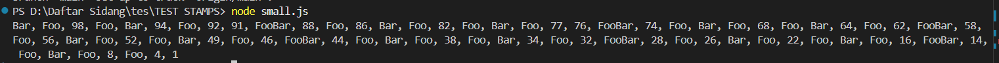
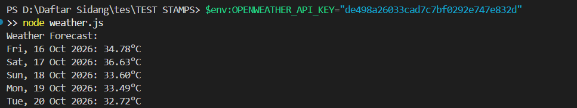

# Test Programming (Node.js)
 
Repositori ini berisi dua program kecil yang ditulis dengan **Node.js**.
 
| No | Program | File |
|----|---------|------|
| 1 | Daftar angka 100 sampai 1 dengan aturan Foo/Bar/FooBar | `small.js` |
| 2 | Prakiraan cuaca Jakarta untuk 5 hari ke depan | `weather.js` |
 
## Prasyarat
 
- [Node.js](https://nodejs.org/) versi **18 atau lebih baru** (program 2 memakai `fetch` bawaan Node).
- Akun gratis di [openweathermap.org](https://openweathermap.org/) untuk mendapatkan API key (hanya untuk program 2).
Cek versi Node.js:
 
```bash
node -v
```
 
---
 
## 1. Small Program (`small.js`)
 
### Deskripsi
 
Membuat array angka 1 sampai 100, lalu mencetaknya **secara terbalik** (100 ke 1) dalam **satu baris (horizontal)** dengan aturan:
 
1. Bilangan prima **tidak dicetak**.
2. Angka kelipatan 3 diganti dengan `Foo`.
3. Angka kelipatan 5 diganti dengan `Bar`.
4. Angka kelipatan 3 dan 5 (kelipatan 15) diganti dengan `FooBar`.
5. Hasil dicetak horizontal, dipisahkan koma.
### Cara kerja
 
- Fungsi `isPrime(n)` mengecek bilangan prima.
- Array `1..100` dibalik, lalu bilangan prima dibuang (`filter`).
- Sisanya diubah (`map`) menjadi `FooBar`, `Foo`, `Bar`, atau angka aslinya. Pengecekan kelipatan 15 dilakukan lebih dulu agar tidak tertimpa `Foo` atau `Bar`.
- Hasil digabung dengan `join(", ")` dan dicetak dengan satu `console.log`.
### Cara menjalankan
 
```bash
node small.js
```
 
output
 


## 2. Weather Forecast Jakarta (`weather.js`)
 
### Deskripsi
 
Menampilkan prakiraan cuaca **Jakarta untuk 5 hari ke depan** dengan **satu suhu per hari**, memakai API dari OpenWeatherMap.
 
- Endpoint: `5 day / 3 hour forecast` (`/data/2.5/forecast`), tersedia di **akun gratis**.
- Satuan suhu: Celsius (`units=metric`).
- Data dari API berupa interval 3 jam. Untuk tiap tanggal, program memilih data yang paling dekat dengan **jam 12 siang waktu Jakarta (UTC+7)** sebagai suhu harian.
- **API key tidak ditulis di source code.** Key dibaca dari environment variable `OPENWEATHER_API_KEY`.
### Mendapatkan API key
 
1. Daftar akun gratis di [openweathermap.org](https://openweathermap.org/).
2. Buka menu **API keys** di profil akun, lalu salin key.
3. Key baru bisa butuh beberapa menit sampai beberapa jam untuk aktif. Selama belum aktif, program akan menampilkan `401 Unauthorized`.
### Cara menjalankan
 
**Windows (PowerShell)**
 
```powershell
$env:OPENWEATHER_API_KEY="API_KEY_ANDA"
node weather.js
```
 
**macOS / Linux (bash)**
 
```bash
export OPENWEATHER_API_KEY="API_KEY_ANDA"
node weather.js
```
  
 output
 

  
## Struktur folder
 
```
.
├── small.js        # Program 1
├── weather.js    # Program 2
└── README.md
```
